[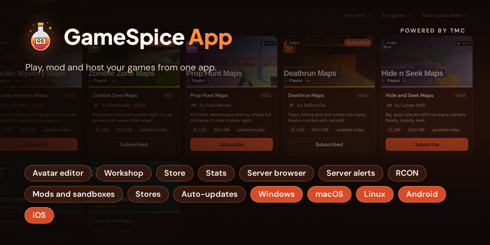](https://gamespice.net/app)

The **official** GameSpice App (Powered by TMC), the desktop home for GameSpice games and the Modding Community: Play, Library, Discover and Servers in one app, built with [Tauri 2](https://tauri.app/), [Rust](https://rust-lang.org/) and [React](https://react.dev/). Its deep links use `gs://` (`tmc://` still works).

## Previews
Shot from the running app in its dark theme, with a demo account on the dev site. Sandboxes, game folders and downloads are seeded, so what you see on your own machine will differ. The screenshots and the banner are rebuilt with `scripts/shots/make-banner.mjs`, see [`scripts/shots/README.md`](scripts/shots/README.md).

| | |
| --- | --- |
| 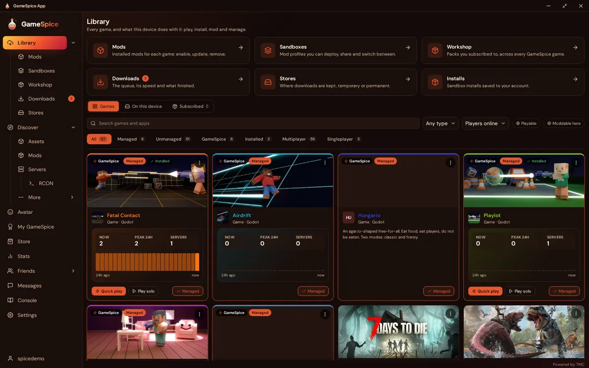<br>Play: your games, with quick play and solo | <br>Avatar editor: pick parts, wearables and emotes |
| 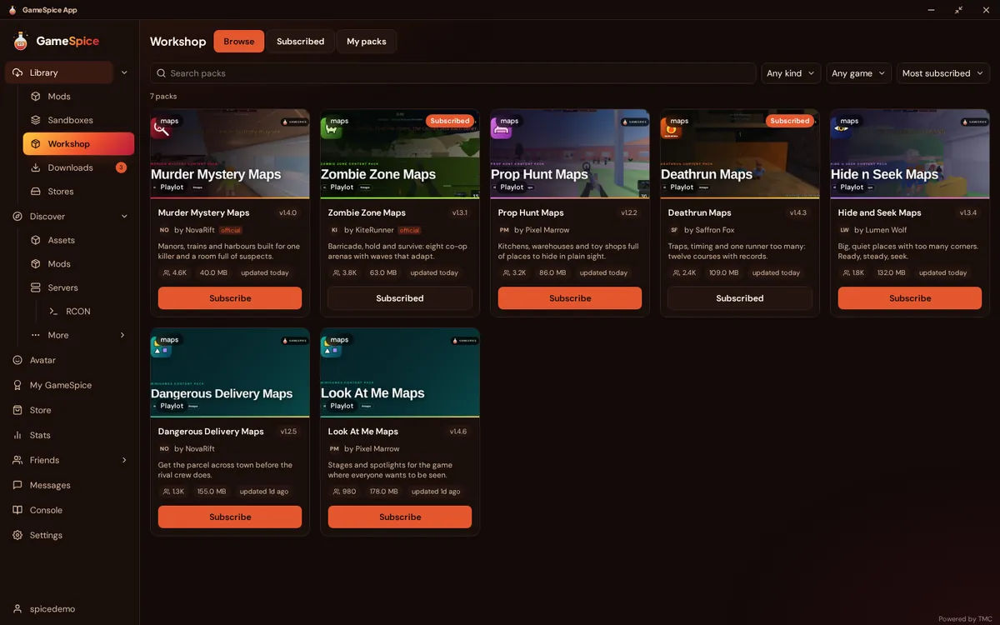<br>Workshop: subscribe to content packs | 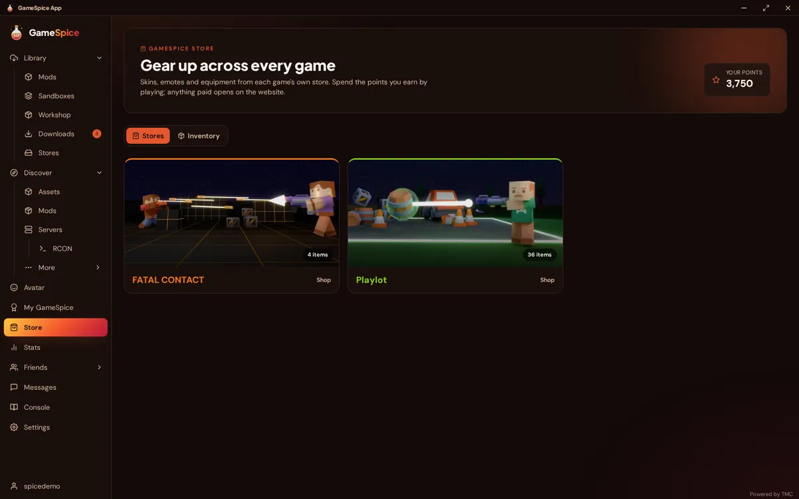<br>Store: outfits and packs for each game |
| 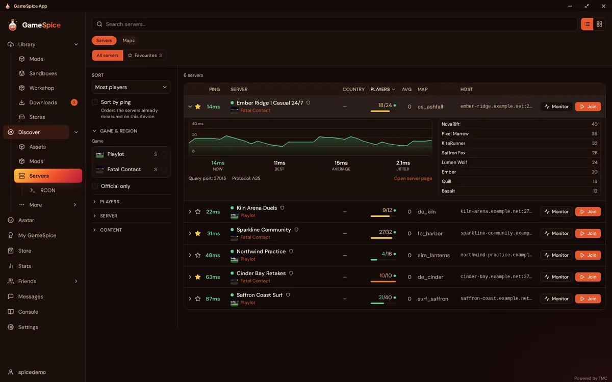<br>Server browser: players and latency from your machine | <br>Server monitor: live latency, players and RCON in one window |
| 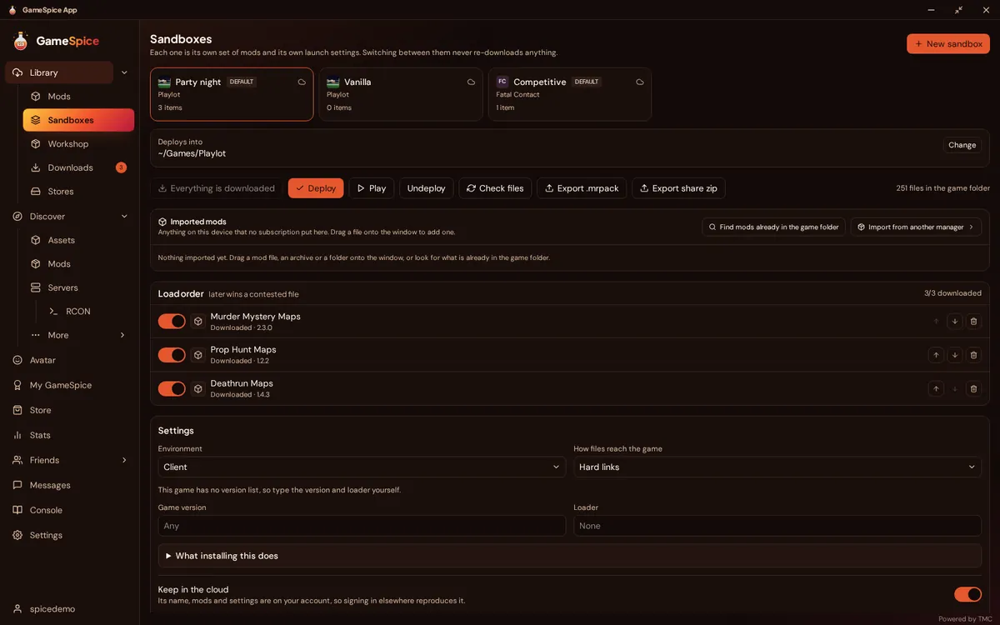<br>Sandboxes: keep mod sets apart | 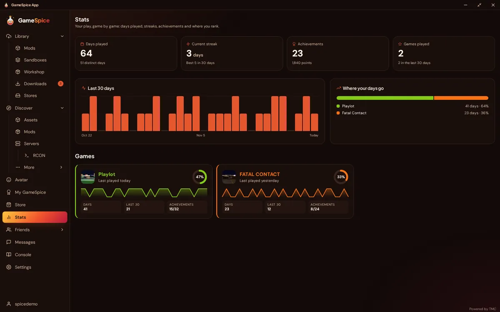<br>Stats: playtime and progress across games |
| 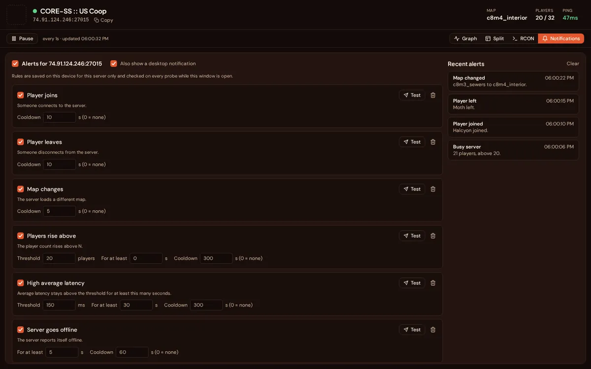<br>Server alerts: rules per server, with desktop notifications | 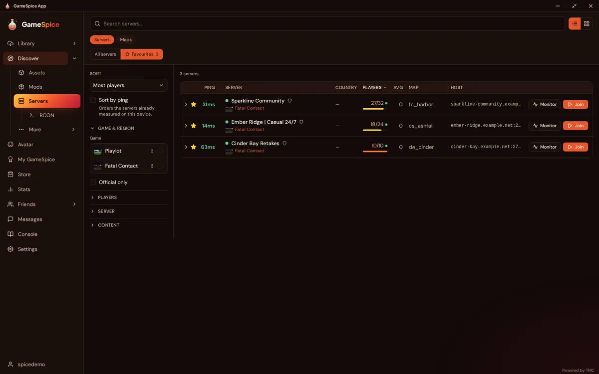<br>Favourite servers: saved to your account or this device |
| 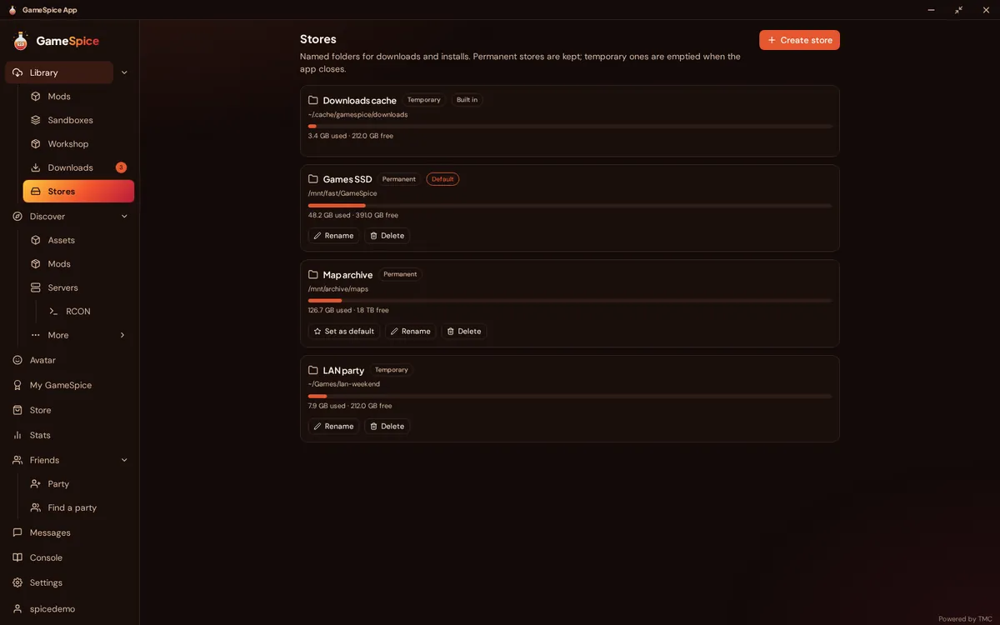<br>Stores: named download folders, permanent or temporary | 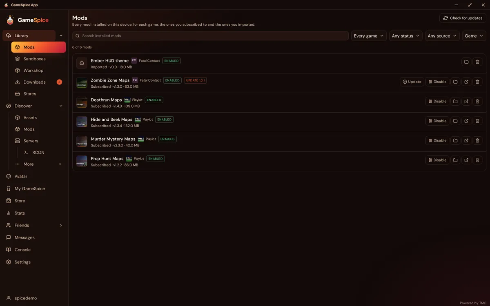<br>Library: managed, unmanaged and GameSpice games |

## What It Does
### Mod Management
- **One-click Install**: Simply click to install or uninstall mods that support installing via the app. The list of [supported games](#supported-games) are at the bottom of this page.
- **Sandboxes**: Named mod profiles per game, with their own load order and their own deployment method.
  - Switching between them does not re-download anything, and your game folder is recoverable either way!
- **Import and export**: Import a Modrinth `.mrpack` or a CurseForge pack as a new sandbox, and export a sandbox as `.mrpack`.
### Game versions and loaders
- **Pick a version, then a loader**: A sandbox picks its game version, its mod loader (Fabric, Forge, NeoForge, Quilt for Minecraft) and the loader's build from lists the website keeps up to date. The app caches them, says when a list is out of date, and still works offline from the last copy or the list built into the app.
- **See what installing does before it happens**: Every download, every program an installer runs (with its full command line) and every licence is listed before you agree. A loader installer that runs a program needs your consent once per plan, and only runs if it is signed by a key built into the app.
- **Shared, sealed layers**: A loader build is installed once into a read-only layer and shared by every sandbox that uses it; removing the sandbox puts the game folder back byte for byte. The same pipeline is data-driven, so other games and loaders need manifests, not code. See [`docs/loaders-and-versions.md`](docs/loaders-and-versions.md).
### Server Management
- **Server Browser**: A full server browser like the one on the website, but with **real-time latency** and **server status** along with latency charts & graphs. You can also filter by game version, mod list, and more.
- **RCON**: Remote console access to your servers, with a full command history and logging. You can also send commands to multiple servers at once, and even schedule commands to be sent at a later time.
- **Favourites**: Star a server to keep it on the *Favourites* tab. Signed in, the list is saved to your account and follows you to every machine; signed out, it stays on this device.
- **Server monitor**: Open any server in its own window: a latency graph, a player chart, and min, average, max, p95, jitter and packet loss for the range you pick. Tabs show the players, server variables, details and chat; RCON can sit beside the graph.
- **Alerts**: Rules per server for a player joining or leaving, a map change, the server going offline or not answering, latency staying high, or the player count passing a number. Alerts show in the monitor and as desktop notifications, with a list of recent ones.
- **Connect**: One-click connect to servers that support it, with the ability to save your login credentials for future use.
- **Console**: The `tmc` command-line tool as a terminal inside the app (desktop). Release builds include `tmc`, so it works with nothing else installed; `TMC_CLI_PATH` points it at another build. See [docs/console.md](docs/console.md).
### Gaming Platform
- **Integrated Game Launcher**: Launch external games from the app, or launch integrated games right within the built-in Game Player, in a window of its own or full screen.
- **Install TMC's own games**: Games we publish are downloaded and installed by the app for whatever machine you are on, kept up to date automatically, and started as real programs rather than in a browser. You can turn automatic updates off per game, and remove one at any time.
- **UDP or TCP**: TMC games join over UDP by default; Settings → App → *Connect over UDP* off switches to TCP (WebSocket) for networks that drop UDP. Both kinds of player share the same server.
- **Join from a link**: A `gs://play/<host>:<port>` link from the website opens the app on that server, showing which game is running there and the latency measured from *your* machine, with the ways you can actually join it. It never joins on its own.
- **Find fun games or servers**: Our gaming platform relies on third-party communities creating games and servers. Browse these games and servers right through our app and connect to them with one click!
- **Assets**: Automatically download and install game assets onto servers where the game supports it (integrated games only).
- **Library**: Every game in one catalogue, with tabs for the games the app manages, the ones it found on your machine and GameSpice games. *Library → Mods* lists every installed mod.
- **Workshop**: Browse map and mod packs, subscribe and they stay up to date, or pause one. Edit or remove your own packs from the same page; new uploads happen on the website.
- **Stores**: Named folders for downloads and installs on any drive. A permanent store is kept, a temporary one is emptied when the app closes, and each shows the space it uses and the space left.
- **Game pages**: Every game has its own page, play it, see its busiest servers, and browse its **leaderboards** for any stat its servers record, with your own rank and figures beside them.
- **Friends & parties**: Your friends list with who is online and which game and server they are on (one click to their server), friend requests, "Add friend" on any profile, party invites, and the party you are in, the same friends and parties the games themselves show.

### Staying Up To Date
- **Automatic updates**: The app checks for a new version on launch and installs it itself, every update is signature-checked against a key built into the app before anything is replaced. Pick the **Stable** or **Beta** channel, or press **Check for updates**, under Settings → App → Updates. Administrators can point the updater at a different source and key there too. See [`docs/RELEASING.md`](docs/RELEASING.md).

## Device Support
| Platform | Status |
| --- | --- |
| Linux | ✅ |
| Windows | ✅ |
| macOS | ✅ |
| Android | ✅ |
| iOS | ✅ |

## From Maintainer & WARNING
This application was built initially with **Claude Code** and will continue to be maintained and extended using it. This is because I (`gamemann`) cannot build the entire TMC platform alone (I wish I could lol).

**Please treat this as partially tested.** I've tested many things in the app, but there are still many things that need to be tested and verified. If you find any bugs or issues, please report them in [issues](https://github.com/gamespice-platform/app/issues).

I intend on reviewing code, testing, and editing documentation regularly. If you're interested in helping out, please let me know!

## Installing
### Linux
One line, no root, no package manager, just `curl` and `sh`:

```bash
curl -fsSL https://gamespice.net/install.sh | sh
```

The script verifies the download against the release's checksums, installs into `~/.local`, and registers the launcher entry and the `gs://` scheme. Undo it with `… | sh -s -- --uninstall`.

### Windows
You can install the app onto your computer using the `setup` executables (`setup.exe` or `setup.msi`) in the releases.

The `portable` executable is also available for those who want to run the app without installing it. The portable version **DOES NOT** register the launcher entry or the `gs://` scheme.

### macOS
Install using the included `.dmg` file.

### Android
Download `GameSpice_<version>.apk` from the releases and open it (allow installs from your browser or file manager when asked). `gs://` and `tmc://` links open the app. The `.aab` is for Google Play. If a release says its APK is debug-signed, it was built without the maintainer's signing key: use it for testing only.

### iOS
`GameSpice_<version>.ipa` is attached to a release only when the maintainer's Apple Developer credentials were available when it was built. It is an ad-hoc build for registered devices, or a TestFlight / App Store upload.

## Development
### Getting Started
```bash
npm install
npm run desktop      # or: android / ios
```

Linux desktop builds need `webkit2gtk-4.1`, `libsoup-3.0` and `pkg-config`, or `npm run sysroot`, which builds a private one without needing root.

### Targeting Platforms
```bash
npm run build:linux      # AppImage + deb
npm run build:windows    # portable exe, .exe setup and .msi, FROM LINUX
```

The Windows build cross-compiles: `cargo-xwin` for the compile, `makensis` for
the setup, `wixl` for the MSI. macOS is the one target that genuinely needs its
own machine, and comes from CI. [`docs/BUILDING.md`](docs/BUILDING.md) has the
prerequisites and the caveats (unsigned binaries, WebView2 in the MSI);
[`docs/RELEASING.md`](docs/RELEASING.md) has the release process, the S3
downloads bucket and the updater's signing key.

## Contributing Plugins
A plugin is a folder with a `plugin.json` in it. See `examples/plugins/` for a
working installer, server-query and theme plugin, and [`docs/plugins.md`](docs/plugins.md) and
[`docs/sandboxes.md`](docs/sandboxes.md) for the format and the sandbox rules. We will be improving this system over time.

**Per-game rules**:
  - Where a game's mods go
  - How it launches
  - How its sandboxes behave

All of these live in `plugins/app/<slug>/` and are compiled into the binary.

Adding a game is four small JSON files and no Rust; [`scripts/gen-app-rules.py`](scripts/gen-app-rules.py) writes the first draft.

**Plugins are data, not code**: They describe steps the app carries out inside a jail the user grants, and every action is written to the activity log.

## Supported Games
Here's a full list of the games that the app currently *supports*. The **Mods land in** column is where the app will deploy mods for that game, and the "Tested" column indicates whether or not the deployment has been tested with that game.

All games right now **haven't been tested**. We will be testing and verifying the deployment of mods for each game in the future.
The tables below are written by [`scripts/gen-readme-games.py`](scripts/gen-readme-games.py) from the rules under `plugins/app/`; run it after adding a game.

<!-- games:begin -->

<details><summary><b>BepInEx</b> (268 games)</summary>

| Game | Mods land in | Tested |
| --- | --- | :-: |
| 20 Minutes Till Dawn | `BepInEx/plugins/`, `BepInEx/patchers/`, `BepInEx/config/` | **No** |
| 9 Kings | `BepInEx/plugins/`, `BepInEx/patchers/`, `BepInEx/config/` | **No** |
| A Gentlemen's Dispute | `BepInEx/plugins/`, `BepInEx/patchers/`, `BepInEx/config/` | **No** |
| A Little to the Left | `BepInEx/plugins/`, `BepInEx/patchers/`, `BepInEx/config/` | **No** |
| A Webbing Journey | `BepInEx/plugins/`, `BepInEx/patchers/`, `BepInEx/config/` | **No** |
| Across the Obelisk | `BepInEx/plugins/`, `BepInEx/patchers/`, `BepInEx/config/` | **No** |
| Aeruta | `BepInEx/plugins/`, `BepInEx/patchers/`, `BepInEx/config/` | **No** |
| Afterbeat | `BepInEx/plugins/`, `BepInEx/patchers/`, `BepInEx/config/` | **No** |
| AGAINST | `BepInEx/plugins/`, `BepInEx/patchers/`, `BepInEx/config/` | **No** |
| Against the Storm | `BepInEx/plugins/`, `BepInEx/patchers/`, `BepInEx/config/` | **No** |
| AI LIMIT | `BepInEx/plugins/`, `BepInEx/patchers/`, `BepInEx/config/` | **No** |
| Airport Security Sucks! | `BepInEx/plugins/`, `BepInEx/patchers/`, `BepInEx/config/` | **No** |
| Ale & Tale Tavern | `BepInEx/plugins/`, `BepInEx/patchers/`, `BepInEx/config/` | **No** |
| Aloft | `BepInEx/plugins/`, `BepInEx/patchers/`, `BepInEx/config/` | **No** |
| Among Us | `BepInEx/plugins/`, `BepInEx/patchers/`, `BepInEx/config/` | **No** |
| Among Us 3D | `BepInEx/plugins/`, `BepInEx/patchers/`, `BepInEx/config/` | **No** |
| ANEURISM IV | `BepInEx/plugins/`, `BepInEx/patchers/`, `BepInEx/config/` | **No** |
| Another Crab's Treasure | `BepInEx/plugins/`, `BepInEx/patchers/`, `BepInEx/config/` | **No** |
| Approximately Up | `BepInEx/plugins/`, `BepInEx/patchers/`, `BepInEx/config/` | **No** |
| Arcus Chroma | `BepInEx/plugins/`, `BepInEx/patchers/`, `BepInEx/config/` | **No** |
| ASKA | `BepInEx/plugins/`, `BepInEx/patchers/`, `BepInEx/config/` | **No** |
| ATLYSS | `BepInEx/plugins/`, `BepInEx/patchers/`, `BepInEx/config/` | **No** |
| Atomicrops | `BepInEx/plugins/`, `BepInEx/patchers/`, `BepInEx/config/` | **No** |
| Atrio: The Dark Wild | `BepInEx/plugins/`, `BepInEx/patchers/`, `BepInEx/config/` | **No** |
| Back to the Dawn | `BepInEx/plugins/`, `BepInEx/patchers/`, `BepInEx/config/` | **No** |
| Bad North | `BepInEx/plugins/`, `BepInEx/patchers/`, `BepInEx/config/` | **No** |
| Below the Stone | `BepInEx/plugins/`, `BepInEx/patchers/`, `BepInEx/config/` | **No** |
| Bendy and the Ink Machine | `BepInEx/plugins/`, `BepInEx/patchers/`, `BepInEx/config/` | **No** |
| Berry Bury Berry | `BepInEx/plugins/`, `BepInEx/patchers/`, `BepInEx/config/` | **No** |
| Betrayal Beach | `BepInEx/plugins/`, `BepInEx/patchers/`, `BepInEx/config/` | **No** |
| Big Walk | `BepInEx/plugins/`, `BepInEx/patchers/`, `BepInEx/config/` | **No** |
| Block Story | `BepInEx/plugins/`, `BepInEx/patchers/`, `BepInEx/config/` | **No** |
| Blue Prince | `BepInEx/plugins/`, `BepInEx/patchers/`, `BepInEx/config/` | **No** |
| Bomb Rush Cyberfunk | `BepInEx/plugins/`, `BepInEx/patchers/`, `BepInEx/config/` | **No** |
| BOMBANANA! | `BepInEx/plugins/`, `BepInEx/patchers/`, `BepInEx/config/` | **No** |
| Book of Travels | `BepInEx/plugins/`, `BepInEx/patchers/`, `BepInEx/config/` | **No** |
| Bopl Battle | `BepInEx/plugins/`, `BepInEx/patchers/`, `BepInEx/config/` | **No** |
| Burglin' Gnomes | `BepInEx/plugins/`, `BepInEx/patchers/`, `BepInEx/config/` | **No** |
| Carrier Deck | `BepInEx/plugins/`, `BepInEx/patchers/`, `BepInEx/config/` | **No** |
| Cat Mail Co. | `BepInEx/plugins/`, `BepInEx/patchers/`, `BepInEx/config/` | **No** |
| Cats are Liquid - A Better Place | `BepInEx/plugins/`, `BepInEx/patchers/`, `BepInEx/config/` | **No** |
| Cave Crawlers | `BepInEx/plugins/`, `BepInEx/patchers/`, `BepInEx/config/` | **No** |
| Chill with You : Lo-Fi Story | `BepInEx/plugins/`, `BepInEx/patchers/`, `BepInEx/config/` | **No** |
| Chrono Ark | `BepInEx/plugins/`, `BepInEx/patchers/`, `BepInEx/config/` | **No** |
| Cities: Skylines II | `BepInEx/plugins/`, `BepInEx/patchers/`, `BepInEx/config/` | **No** |
| CloverPit | `BepInEx/plugins/`, `BepInEx/patchers/`, `BepInEx/config/` | **No** |
| Content Warning | `BepInEx/plugins/`, `BepInEx/patchers/`, `BepInEx/config/` | **No** |
| Core Keeper | `BepInEx/plugins/`, `BepInEx/patchers/`, `BepInEx/config/` | **No** |
| Crab Game | `BepInEx/plugins/`, `BepInEx/patchers/`, `BepInEx/config/` | **No** |
| Crashout Crew | `BepInEx/plugins/`, `BepInEx/patchers/`, `BepInEx/config/` | **No** |
| Crawl | `BepInEx/plugins/`, `BepInEx/patchers/`, `BepInEx/config/` | **No** |
| Crawlspace | `BepInEx/plugins/`, `BepInEx/patchers/`, `BepInEx/config/` | **No** |
| Crawlspace 2 | `BepInEx/plugins/`, `BepInEx/patchers/`, `BepInEx/config/` | **No** |
| Crime Simulator | `BepInEx/plugins/`, `BepInEx/patchers/`, `BepInEx/config/` | **No** |
| Cult of PiN | `BepInEx/plugins/`, `BepInEx/patchers/`, `BepInEx/config/` | **No** |
| Cult of the Lamb | `BepInEx/plugins/`, `BepInEx/patchers/`, `BepInEx/config/` | **No** |
| Cuphead | `BepInEx/plugins/`, `BepInEx/patchers/`, `BepInEx/config/` | **No** |
| Darkwater | `BepInEx/plugins/`, `BepInEx/patchers/`, `BepInEx/config/` | **No** |
| Deadly Delivery | `BepInEx/plugins/`, `BepInEx/patchers/`, `BepInEx/config/` | **No** |
| Deep Rock Galactic: Survivor | `BepInEx/plugins/`, `BepInEx/patchers/`, `BepInEx/config/` | **No** |
| DEPO : Death Epileptic Pixel Origins | `BepInEx/plugins/`, `BepInEx/patchers/`, `BepInEx/config/` | **No** |
| Dice Kingdoms | `BepInEx/plugins/`, `BepInEx/patchers/`, `BepInEx/config/` | **No** |
| Disco Elysium | `BepInEx/plugins/`, `BepInEx/patchers/`, `BepInEx/config/` | **No** |
| Distance | `BepInEx/plugins/`, `BepInEx/patchers/`, `BepInEx/config/` | **No** |
| DREDGE | `BepInEx/plugins/`, `BepInEx/patchers/`, `BepInEx/config/` | **No** |
| DUSK | `BepInEx/plugins/`, `BepInEx/patchers/`, `BepInEx/config/` | **No** |
| Dyson Sphere Program | `BepInEx/plugins/`, `BepInEx/patchers/`, `BepInEx/config/` | **No** |
| Easy Delivery Co | `BepInEx/plugins/`, `BepInEx/patchers/`, `BepInEx/config/` | **No** |
| Electoral Carnage | `BepInEx/plugins/`, `BepInEx/patchers/`, `BepInEx/config/` | **No** |
| ENA: Dream BBQ | `BepInEx/plugins/`, `BepInEx/patchers/`, `BepInEx/config/` | **No** |
| Enter the Gungeon | `BepInEx/plugins/`, `BepInEx/patchers/`, `BepInEx/config/` | **No** |
| Erenshor | `BepInEx/plugins/`, `BepInEx/patchers/`, `BepInEx/config/` | **No** |
| Everything is Crab | `BepInEx/plugins/`, `BepInEx/patchers/`, `BepInEx/config/` | **No** |
| Factory Planner | `BepInEx/plugins/`, `BepInEx/patchers/`, `BepInEx/config/` | **No** |
| FATE: Reawakened | `BepInEx/plugins/`, `BepInEx/patchers/`, `BepInEx/config/` | **No** |
| Five Nights at Freddy's: Into the Pit | `BepInEx/plugins/`, `BepInEx/patchers/`, `BepInEx/config/` | **No** |
| Football Manager 26 | `BepInEx/plugins/`, `BepInEx/patchers/`, `BepInEx/config/` | **No** |
| For The King | `BepInEx/plugins/`, `BepInEx/patchers/`, `BepInEx/config/` | **No** |
| Frozen Ship | `BepInEx/plugins/`, `BepInEx/patchers/`, `BepInEx/config/` | **No** |
| Gamble With Your Friends | `BepInEx/plugins/`, `BepInEx/patchers/`, `BepInEx/config/` | **No** |
| Garfield Kart - Furious Racing | `BepInEx/plugins/`, `BepInEx/patchers/`, `BepInEx/config/` | **No** |
| Gatekeeper | `BepInEx/plugins/`, `BepInEx/patchers/`, `BepInEx/config/` | **No** |
| Getting Over It with Bennett Foddy | `BepInEx/plugins/`, `BepInEx/patchers/`, `BepInEx/config/` | **No** |
| Gladio Mori | `BepInEx/plugins/`, `BepInEx/patchers/`, `BepInEx/config/` | **No** |
| Gloomwood | `BepInEx/plugins/`, `BepInEx/patchers/`, `BepInEx/config/` | **No** |
| Goblin Buster: Incremental Tower Defense | `BepInEx/plugins/`, `BepInEx/patchers/`, `BepInEx/config/` | **No** |
| Goblin Cleanup | `BepInEx/plugins/`, `BepInEx/patchers/`, `BepInEx/config/` | **No** |
| Goodbye Volcano High | `BepInEx/plugins/`, `BepInEx/patchers/`, `BepInEx/config/` | **No** |
| GoreBox | `BepInEx/plugins/`, `BepInEx/patchers/`, `BepInEx/config/` | **No** |
| Granny: Chapter Two | `BepInEx/plugins/`, `BepInEx/patchers/`, `BepInEx/config/` | **No** |
| Graveyard Keeper 2 | `BepInEx/plugins/`, `BepInEx/patchers/`, `BepInEx/config/` | **No** |
| Green Hell VR | `BepInEx/plugins/`, `BepInEx/patchers/`, `BepInEx/config/` | **No** |
| Grey Hack | `BepInEx/plugins/`, `BepInEx/patchers/`, `BepInEx/config/` | **No** |
| GRIME | `BepInEx/plugins/`, `BepInEx/patchers/`, `BepInEx/config/` | **No** |
| GTFO | `BepInEx/plugins/`, `BepInEx/patchers/`, `BepInEx/config/` | **No** |
| Guilty as Sock! | `BepInEx/plugins/`, `BepInEx/patchers/`, `BepInEx/config/` | **No** |
| Gunman Contracts - Stand Alone | `BepInEx/plugins/`, `BepInEx/patchers/`, `BepInEx/config/` | **No** |
| H3VR | `BepInEx/plugins/`, `BepInEx/patchers/`, `BepInEx/config/` | **No** |
| Hard Time III | `BepInEx/plugins/`, `BepInEx/patchers/`, `BepInEx/config/` | **No** |
| Holdfast: Nations At War | `BepInEx/plugins/`, `BepInEx/patchers/`, `BepInEx/config/` | **No** |
| Hollow Knight: Silksong | `BepInEx/plugins/` | **No** |
| Hot Lava | `BepInEx/plugins/`, `BepInEx/patchers/`, `BepInEx/config/` | **No** |
| House of Legacy | `BepInEx/plugins/`, `BepInEx/patchers/`, `BepInEx/config/` | **No** |
| House of the Dying Sun | `BepInEx/plugins/`, `BepInEx/patchers/`, `BepInEx/config/` | **No** |
| How to Fish | `BepInEx/plugins/`, `BepInEx/patchers/`, `BepInEx/config/` | **No** |
| Human Fall Flat | `BepInEx/plugins/`, `BepInEx/patchers/`, `BepInEx/config/` | **No** |
| I Am Your Beast | `BepInEx/plugins/`, `BepInEx/patchers/`, `BepInEx/config/` | **No** |
| In Falsus | `BepInEx/plugins/`, `BepInEx/patchers/`, `BepInEx/config/` | **No** |
| Inferno Protocol | `BepInEx/plugins/`, `BepInEx/patchers/`, `BepInEx/config/` | **No** |
| Inscryption | `BepInEx/plugins/`, `BepInEx/patchers/`, `BepInEx/config/` | **No** |
| IRONSTRIKE | `BepInEx/plugins/`, `BepInEx/patchers/`, `BepInEx/config/` | **No** |
| Island Market Simulator | `BepInEx/plugins/`, `BepInEx/patchers/`, `BepInEx/config/` | **No** |
| KeyWe | `BepInEx/plugins/`, `BepInEx/patchers/`, `BepInEx/config/` | **No** |
| Last Pirates: Die Together | `BepInEx/plugins/`, `BepInEx/patchers/`, `BepInEx/config/` | **No** |
| Last Train Outta' Wormtown | `BepInEx/plugins/`, `BepInEx/patchers/`, `BepInEx/config/` | **No** |
| Lazy Witch's Factory | `BepInEx/plugins/`, `BepInEx/patchers/`, `BepInEx/config/` | **No** |
| Len's Island | `BepInEx/plugins/`, `BepInEx/patchers/`, `BepInEx/config/` | **No** |
| Lethal Company | `BepInEx/plugins/`, `BepInEx/patchers/`, `BepInEx/config/` | **No** |
| Lethal League Blaze | `BepInEx/plugins/`, `BepInEx/patchers/`, `BepInEx/config/` | **No** |
| Limitless Survivor | `BepInEx/plugins/`, `BepInEx/patchers/`, `BepInEx/config/` | **No** |
| Logic World | `BepInEx/plugins/`, `BepInEx/patchers/`, `BepInEx/config/` | **No** |
| Lootun | `BepInEx/plugins/`, `BepInEx/patchers/`, `BepInEx/config/` | **No** |
| Lost Skies | `BepInEx/plugins/`, `BepInEx/patchers/`, `BepInEx/config/` | **No** |
| Lost Skies Island Creator | `BepInEx/plugins/`, `BepInEx/patchers/`, `BepInEx/config/` | **No** |
| Lucky Shot | `BepInEx/plugins/`, `BepInEx/patchers/`, `BepInEx/config/` | **No** |
| LumenTale: Memories of Trey | `BepInEx/plugins/`, `BepInEx/patchers/`, `BepInEx/config/` | **No** |
| Lycans | `BepInEx/plugins/`, `BepInEx/patchers/`, `BepInEx/config/` | **No** |
| Mage Arena | `BepInEx/plugins/`, `BepInEx/patchers/`, `BepInEx/config/` | **No** |
| Magicite | `BepInEx/plugins/`, `BepInEx/patchers/`, `BepInEx/config/` | **No** |
| Magicraft | `BepInEx/plugins/`, `BepInEx/patchers/`, `BepInEx/config/` | **No** |
| Make Way | `BepInEx/plugins/`, `BepInEx/patchers/`, `BepInEx/config/` | **No** |
| Maltese's Fluffy Onsen | `BepInEx/plugins/`, `BepInEx/patchers/`, `BepInEx/config/` | **No** |
| Mechanica | `BepInEx/plugins/`, `BepInEx/patchers/`, `BepInEx/config/` | **No** |
| Meeple Station | `BepInEx/plugins/`, `BepInEx/patchers/`, `BepInEx/config/` | **No** |
| Megabonk | `BepInEx/plugins/`, `BepInEx/patchers/`, `BepInEx/config/` | **No** |
| MineMogul | `BepInEx/plugins/`, `BepInEx/patchers/`, `BepInEx/config/` | **No** |
| Minigunner | `BepInEx/plugins/`, `BepInEx/patchers/`, `BepInEx/config/` | **No** |
| MiSide | `BepInEx/plugins/`, `BepInEx/patchers/`, `BepInEx/config/` | **No** |
| Modulus: Factory Automation | `BepInEx/plugins/`, `BepInEx/patchers/`, `BepInEx/config/` | **No** |
| Monster Train 2 | `BepInEx/plugins/`, `BepInEx/patchers/`, `BepInEx/config/` | **No** |
| Moonlighter | `BepInEx/plugins/`, `BepInEx/patchers/`, `BepInEx/config/` | **No** |
| Muck | `BepInEx/plugins/`, `BepInEx/patchers/`, `BepInEx/config/` | **No** |
| My Dream Setup | `BepInEx/plugins/`, `BepInEx/patchers/`, `BepInEx/config/` | **No** |
| Mycopunk | `BepInEx/plugins/`, `BepInEx/patchers/`, `BepInEx/config/` | **No** |
| Nearly Dead | `BepInEx/plugins/`, `BepInEx/patchers/`, `BepInEx/config/` | **No** |
| Necropolis | `BepInEx/plugins/`, `BepInEx/patchers/`, `BepInEx/config/` | **No** |
| Nickelodeon All‑Star Brawl | `BepInEx/plugins/`, `BepInEx/patchers/`, `BepInEx/config/` | **No** |
| Nine Sols | `BepInEx/plugins/`, `BepInEx/patchers/`, `BepInEx/config/` | **No** |
| Nivalis Nights | `BepInEx/plugins/`, `BepInEx/patchers/`, `BepInEx/config/` | **No** |
| Nuclear Option | `BepInEx/plugins/`, `BepInEx/patchers/`, `BepInEx/config/` | **No** |
| Nucleares | `BepInEx/plugins/`, `BepInEx/patchers/`, `BepInEx/config/` | **No** |
| Odd Remedy | `BepInEx/plugins/`, `BepInEx/patchers/`, `BepInEx/config/` | **No** |
| Old Market Simulator | `BepInEx/plugins/`, `BepInEx/patchers/`, `BepInEx/config/` | **No** |
| On-Together: Virtual Co-Working | `BepInEx/plugins/`, `BepInEx/patchers/`, `BepInEx/config/` | **No** |
| Ostranauts | `BepInEx/plugins/`, `BepInEx/patchers/`, `BepInEx/config/` | **No** |
| Outward | `BepInEx/plugins/`, `BepInEx/patchers/`, `BepInEx/config/` | **No** |
| PAC-MAN WORLD Re-PAC | `BepInEx/plugins/`, `BepInEx/patchers/`, `BepInEx/config/` | **No** |
| Paper Animal Adventure | `BepInEx/plugins/`, `BepInEx/patchers/`, `BepInEx/config/` | **No** |
| Papers, Please | `BepInEx/plugins/`, `BepInEx/patchers/`, `BepInEx/config/` | **No** |
| Paquerette Down the Bunburrows | `BepInEx/plugins/`, `BepInEx/patchers/`, `BepInEx/config/` | **No** |
| Paralives | `BepInEx/plugins/`, `BepInEx/patchers/`, `BepInEx/config/` | **No** |
| PATAPON 1+2 REPLAY | `BepInEx/plugins/`, `BepInEx/patchers/`, `BepInEx/config/` | **No** |
| PEAK | `BepInEx/plugins/`, `BepInEx/patchers/`, `BepInEx/config/` | **No** |
| Peaks of Yore | `BepInEx/plugins/`, `BepInEx/patchers/`, `BepInEx/config/` | **No** |
| Peglin | `BepInEx/plugins/`, `BepInEx/patchers/`, `BepInEx/config/` | **No** |
| PIGFACE | `BepInEx/plugins/`, `BepInEx/patchers/`, `BepInEx/config/` | **No** |
| Pikuniku | `BepInEx/plugins/`, `BepInEx/patchers/`, `BepInEx/config/` | **No** |
| Plasma | `BepInEx/plugins/`, `BepInEx/patchers/`, `BepInEx/config/` | **No** |
| Potion Craft | `BepInEx/plugins/`, `BepInEx/patchers/`, `BepInEx/config/` | **No** |
| Project Gorgon | `BepInEx/plugins/`, `BepInEx/patchers/`, `BepInEx/config/` | **No** |
| Pulsar: Lost Colony | `BepInEx/plugins/`, `BepInEx/patchers/`, `BepInEx/config/` | **No** |
| Pummel Party | `BepInEx/plugins/`, `BepInEx/patchers/`, `BepInEx/config/` | **No** |
| Pushing it! Together - Sisyphus Co-op | `BepInEx/plugins/`, `BepInEx/patchers/`, `BepInEx/config/` | **No** |
| R.E.P.O. | `BepInEx/plugins/`, `BepInEx/patchers/`, `BepInEx/config/` | **No** |
| Raft | `BepInEx/plugins/`, `BepInEx/patchers/`, `BepInEx/config/` | **No** |
| Ravenfield | `BepInEx/plugins/`, `BepInEx/patchers/`, `BepInEx/config/` | **No** |
| Re:Legend | `BepInEx/plugins/`, `BepInEx/patchers/`, `BepInEx/config/` | **No** |
| Receiver 2 | `BepInEx/plugins/`, `BepInEx/patchers/`, `BepInEx/config/` | **No** |
| Resonite | `BepInEx/plugins/`, `Renderer/BepInEx/plugins/`, `BepInEx/config/` | **No** |
| Return From Core | `BepInEx/plugins/`, `BepInEx/patchers/`, `BepInEx/config/` | **No** |
| Return of the Obra Dinn | `BepInEx/plugins/`, `BepInEx/patchers/`, `BepInEx/config/` | **No** |
| Rhythm Doctor | `BepInEx/plugins/`, `BepInEx/patchers/`, `BepInEx/config/` | **No** |
| Risk of Rain 2 | `BepInEx/plugins/`, `BepInEx/patchers/`, `BepInEx/config/` | **No** |
| Roadside Research | `BepInEx/plugins/`, `BepInEx/patchers/`, `BepInEx/config/` | **No** |
| Rogue : Genesia | `BepInEx/plugins/`, `BepInEx/patchers/`, `BepInEx/config/` | **No** |
| Rogue Tower | `BepInEx/plugins/`, `BepInEx/patchers/`, `BepInEx/config/` | **No** |
| Romestead | `BepInEx/plugins/`, `BepInEx/patchers/`, `BepInEx/config/` | **No** |
| ROUNDS | `BepInEx/plugins/`, `BepInEx/patchers/`, `BepInEx/config/` | **No** |
| Sailwind | `BepInEx/plugins/`, `BepInEx/patchers/`, `BepInEx/config/` | **No** |
| Screw Drivers | `BepInEx/plugins/`, `BepInEx/patchers/`, `BepInEx/config/` | **No** |
| Shadows of Doubt | `BepInEx/plugins/`, `BepInEx/patchers/`, `BepInEx/config/` | **No** |
| Shadows Over Loathing | `BepInEx/plugins/`, `BepInEx/patchers/`, `BepInEx/config/` | **No** |
| Shapez 2 | `BepInEx/plugins/`, `BepInEx/patchers/`, `BepInEx/config/` | **No** |
| Shift At Midnight | `BepInEx/plugins/`, `BepInEx/patchers/`, `BepInEx/config/` | **No** |
| SIDE EFFECTS | `BepInEx/plugins/`, `BepInEx/patchers/`, `BepInEx/config/` | **No** |
| Sineus Arena Survivors | `BepInEx/plugins/`, `BepInEx/patchers/`, `BepInEx/config/` | **No** |
| Skul: The Hero Slayer | `BepInEx/plugins/`, `BepInEx/patchers/`, `BepInEx/config/` | **No** |
| Slasher's Keep | `BepInEx/plugins/`, `BepInEx/patchers/`, `BepInEx/config/` | **No** |
| Slip & Skid | `BepInEx/plugins/`, `BepInEx/patchers/`, `BepInEx/config/` | **No** |
| Slipstream: Rogue Space | `BepInEx/plugins/`, `BepInEx/patchers/`, `BepInEx/config/` | **No** |
| Smushi Come Home | `BepInEx/plugins/`, `BepInEx/patchers/`, `BepInEx/config/` | **No** |
| Songs of Conquest | `BepInEx/plugins/`, `BepInEx/patchers/`, `BepInEx/config/` | **No** |
| Sons of the Forest | `BepInEx/plugins/`, `BepInEx/patchers/`, `BepInEx/config/` | **No** |
| Soulstone Survivors | `BepInEx/plugins/`, `BepInEx/patchers/`, `BepInEx/config/` | **No** |
| Space Cat Digger | `BepInEx/plugins/`, `BepInEx/patchers/`, `BepInEx/config/` | **No** |
| Spooky's Jump Scare Mansion: HD Renovation | `BepInEx/plugins/`, `BepInEx/patchers/`, `BepInEx/config/` | **No** |
| Stacklands | `BepInEx/plugins/`, `BepInEx/patchers/`, `BepInEx/config/` | **No** |
| Starsand | `BepInEx/plugins/`, `BepInEx/patchers/`, `BepInEx/config/` | **No** |
| Stick Fight: The Game | `BepInEx/plugins/`, `BepInEx/patchers/`, `BepInEx/config/` | **No** |
| Stolen Realm | `BepInEx/plugins/`, `BepInEx/patchers/`, `BepInEx/config/` | **No** |
| Stonewards | `BepInEx/plugins/`, `BepInEx/patchers/`, `BepInEx/config/` | **No** |
| STRAFTAT | `BepInEx/plugins/`, `BepInEx/patchers/`, `BepInEx/config/` | **No** |
| Subnautica | `BepInEx/plugins/` | **No** |
| Subnautica: Below Zero | `BepInEx/plugins/` | **No** |
| Subterranauts | `BepInEx/plugins/`, `BepInEx/patchers/`, `BepInEx/config/` | **No** |
| Subterror | `BepInEx/plugins/`, `BepInEx/patchers/`, `BepInEx/config/` | **No** |
| SULFUR | `BepInEx/plugins/`, `BepInEx/patchers/`, `BepInEx/config/` | **No** |
| Sun Haven | `BepInEx/plugins/`, `BepInEx/patchers/`, `BepInEx/config/` | **No** |
| Sunkenland | `BepInEx/plugins/`, `BepInEx/patchers/`, `BepInEx/config/` | **No** |
| Super Battle Golf | `BepInEx/plugins/`, `BepInEx/patchers/`, `BepInEx/config/` | **No** |
| Super Fantasy Kingdom | `BepInEx/plugins/`, `BepInEx/patchers/`, `BepInEx/config/` | **No** |
| Super Psycho Baseball | `BepInEx/plugins/`, `BepInEx/patchers/`, `BepInEx/config/` | **No** |
| Supermarket Together | `BepInEx/plugins/`, `BepInEx/patchers/`, `BepInEx/config/` | **No** |
| Survival: Fountain of Youth | `BepInEx/plugins/`, `BepInEx/patchers/`, `BepInEx/config/` | **No** |
| TABS | `BepInEx/plugins/`, `BepInEx/patchers/`, `BepInEx/config/` | **No** |
| TaleSpire | `BepInEx/plugins/`, `BepInEx/patchers/`, `BepInEx/config/` | **No** |
| Tank Team | `BepInEx/plugins/`, `BepInEx/patchers/`, `BepInEx/config/` | **No** |
| TCG Card Shop Simulator | `BepInEx/plugins/`, `BepInEx/patchers/`, `BepInEx/config/` | **No** |
| Techtonica | `BepInEx/plugins/`, `BepInEx/patchers/`, `BepInEx/config/` | **No** |
| The Farmer Was Replaced | `BepInEx/plugins/`, `BepInEx/patchers/`, `BepInEx/config/` | **No** |
| The Lab | `BepInEx/plugins/`, `BepInEx/patchers/`, `BepInEx/config/` | **No** |
| The Message from Deep Space | `BepInEx/plugins/`, `BepInEx/patchers/`, `BepInEx/config/` | **No** |
| The Ouroboros King | `BepInEx/plugins/`, `BepInEx/patchers/`, `BepInEx/config/` | **No** |
| The Planet Crafter | `BepInEx/plugins/`, `BepInEx/patchers/`, `BepInEx/config/` | **No** |
| The Sexy Brutale | `BepInEx/plugins/`, `BepInEx/patchers/`, `BepInEx/config/` | **No** |
| The Spell Brigade | `BepInEx/plugins/`, `BepInEx/patchers/`, `BepInEx/config/` | **No** |
| Thronefall | `BepInEx/plugins/`, `BepInEx/patchers/`, `BepInEx/config/` | **No** |
| Timberborn | `BepInEx/plugins/`, `BepInEx/patchers/`, `BepInEx/config/` | **No** |
| Tiny Rogues | `BepInEx/plugins/`, `BepInEx/patchers/`, `BepInEx/config/` | **No** |
| TouhouLostBranchOfLegend | `BepInEx/plugins/`, `BepInEx/patchers/`, `BepInEx/config/` | **No** |
| Trash Day | `BepInEx/plugins/`, `BepInEx/patchers/`, `BepInEx/config/` | **No** |
| Trombone Champ | `BepInEx/plugins/`, `BepInEx/patchers/`, `BepInEx/config/` | **No** |
| Tunguska: The Visitation | `BepInEx/plugins/`, `BepInEx/patchers/`, `BepInEx/config/` | **No** |
| Ultimate Chicken Horse | `BepInEx/plugins/`, `BepInEx/patchers/`, `BepInEx/config/` | **No** |
| ULTRAKILL | `BepInEx/plugins/`, `BepInEx/patchers/`, `BepInEx/config/` | **No** |
| Unfair Flips | `BepInEx/plugins/`, `BepInEx/patchers/`, `BepInEx/config/` | **No** |
| Untitled Goose Game | `BepInEx/plugins/`, `BepInEx/patchers/`, `BepInEx/config/` | **No** |
| V Rising | `BepInEx/plugins/`, `BepInEx/patchers/`, `BepInEx/config/` | **No** |
| Valheim | `BepInEx/plugins/`, `BepInEx/patchers/`, `BepInEx/config/` | **No** |
| Vampire Crawlers | `BepInEx/plugins/`, `BepInEx/patchers/`, `BepInEx/config/` | **No** |
| Vertigo 2 | `BepInEx/plugins/`, `BepInEx/patchers/`, `BepInEx/config/` | **No** |
| Very Very Valet | `BepInEx/plugins/`, `BepInEx/patchers/`, `BepInEx/config/` | **No** |
| Void Crew | `BepInEx/plugins/`, `BepInEx/patchers/`, `BepInEx/config/` | **No** |
| Voodoo Fishin' | `BepInEx/plugins/`, `BepInEx/patchers/`, `BepInEx/config/` | **No** |
| VTOL VR | `BepInEx/plugins/`, `BepInEx/patchers/`, `BepInEx/config/` | **No** |
| Waterpark Simulator | `BepInEx/plugins/`, `BepInEx/patchers/`, `BepInEx/config/` | **No** |
| We Love Katamari REROLL+ Royal Reverie | `BepInEx/plugins/`, `BepInEx/patchers/`, `BepInEx/config/` | **No** |
| West of Loathing | `BepInEx/plugins/`, `BepInEx/patchers/`, `BepInEx/config/` | **No** |
| Whisper of the House | `BepInEx/plugins/`, `BepInEx/patchers/`, `BepInEx/config/` | **No** |
| White Knuckle | `BepInEx/plugins/`, `BepInEx/patchers/`, `BepInEx/config/` | **No** |
| Wildfrost | `BepInEx/plugins/`, `BepInEx/patchers/`, `BepInEx/config/` | **No** |
| Wizard of Legend | `BepInEx/plugins/`, `BepInEx/patchers/`, `BepInEx/config/` | **No** |
| Wizard With A Gun | `BepInEx/plugins/`, `BepInEx/patchers/`, `BepInEx/config/` | **No** |
| Wobbly Life | `BepInEx/plugins/`, `BepInEx/patchers/`, `BepInEx/config/` | **No** |
| Word Play | `BepInEx/plugins/`, `BepInEx/patchers/`, `BepInEx/config/` | **No** |
| Wrestling Empire | `BepInEx/plugins/`, `BepInEx/patchers/`, `BepInEx/config/` | **No** |
| YAPYAP | `BepInEx/plugins/`, `BepInEx/patchers/`, `BepInEx/config/` | **No** |
| Zort | `BepInEx/plugins/`, `BepInEx/patchers/`, `BepInEx/config/` | **No** |

</details>

<details><summary><b>Loader and other plugin folders</b> (69 games)</summary>

| Game | Mods land in | Tested |
| --- | --- | :-: |
| An Unfinished Game | `Mods/`, `UserData/` | **No** |
| Angry Birds VR: Isle of Pigs | `Mods/`, `UserData/` | **No** |
| Astroneer | `shimloader/mod/`, `shimloader/pak/`, `shimloader/cfg/` | **No** |
| Baby Steps | `Mods/`, `UserData/` | **No** |
| Backpack Hero | `Mods/`, `Plugins/`, `UserData/` | **No** |
| Beetleball | `Mods/`, `UserData/` | **No** |
| BETON BRUTAL | `Mods/`, `UserData/` | **No** |
| Big Ambitions | `Mods/`, `UserData/` | **No** |
| BloonsTD6 | `Mods/`, `UserData/` | **No** |
| BONELAB | `Mods/`, `Plugins/`, `UserData/` | **No** |
| BONEWORKS | `Mods/`, `Plugins/`, `UserData/` | **No** |
| BRUTALISTICK VR | `Mods/`, `UserData/` | **No** |
| Cairn | `Mods/`, `UserData/` | **No** |
| Cast n Chill | `Mods/`, `UserData/` | **No** |
| CRYO | `Mods/`, `UserData/` | **No** |
| Cursed Words | `Mods/`, `UserData/` | **No** |
| Dale & Dawson Stationery Supplies | `Mods/`, `UserData/` | **No** |
| Ducks Can Drive | `Mods/`, `UserData/` | **No** |
| Enderal: Forgotten Stories | `Data/`, `Data/`, `Data/SKSE/Plugins/` | **No** |
| Enderal: Forgotten Stories (Special Edition) | `Data/`, `Data/`, `Data/SKSE/Plugins/` | **No** |
| Fallout 3 | `Data/`, `Data/`, `Data/FOSE/Plugins/` | **No** |
| Fallout 4 | `Data/`, `Data/`, `Data/F4SE/Plugins/` | **No** |
| Fallout 4 VR | `Data/`, `Data/`, `Data/F4SE/Plugins/` | **No** |
| Fallout: New Vegas | `Data/`, `Data/`, `Data/NVSE/Plugins/` | **No** |
| Forsaken Frontiers | `Mods/`, `UserData/` | **No** |
| FRUKT | `Mods/`, `UserData/` | **No** |
| Gang Beasts | `Mods/`, `UserData/` | **No** |
| Gorilla Tag | `Mods/`, `UserData/` | **No** |
| Grain Rot | `shimloader/mod/`, `shimloader/pak/`, `shimloader/cfg/` | **No** |
| Grand Theft Auto III | `modloader/`, game root | **No** |
| Grand Theft Auto IV | game root, `scripts/` | **No** |
| Grand Theft Auto: San Andreas | `modloader/`, game root | **No** |
| Grand Theft Auto: Vice City | `modloader/`, game root | **No** |
| Hades II | `ReturnOfModding/plugins/`, `ReturnOfModding/config/` | **No** |
| Hard Bullet | `Mods/`, `Plugins/`, `UserData/` | **No** |
| Home Safety Hotline | `Mods/`, `UserData/` | **No** |
| Inside The Backrooms | `Mods/`, `UserData/` | **No** |
| IRON NEST: Heavy Turret Simulator | `Mods/`, `UserData/` | **No** |
| Jump Space | `Mods/`, `UserData/` | **No** |
| Labyrinthine | `Mods/`, `UserData/` | **No** |
| MECCHA CHAMELEON | `shimloader/mod/`, `shimloader/pak/`, `shimloader/cfg/` | **No** |
| Mimesis | `Mods/`, `UserData/` | **No** |
| Minecraft | `mods/`, `resourcepacks/`, `shaderpacks/` | **No** |
| MINOS | `shimloader/mod/`, `shimloader/pak/`, `shimloader/cfg/` | **No** |
| Nehrim: At Fate's Edge | `Data/` | **No** |
| Offscreen | `Mods/`, `UserData/` | **No** |
| Painting VR | `Mods/`, `UserData/` | **No** |
| Panicore | `shimloader/mod/`, `shimloader/pak/`, `shimloader/cfg/` | **No** |
| Patch Quest | `Mods/`, `Plugins/`, `UserData/` | **No** |
| Pit of Goblin | `Mods/`, `UserData/` | **No** |
| Puttler | `Mods/`, `UserData/` | **No** |
| Risk of Rain Returns | `ReturnOfModding/plugins/`, `ReturnOfModding/config/` | **No** |
| RUMBLE | `Mods/`, `Plugins/`, `UserData/` | **No** |
| RV There Yet? | `shimloader/mod/`, `shimloader/pak/`, `shimloader/cfg/` | **No** |
| Schedule I | `Mods/` | **No** |
| Scrap Mechanic | `Rivet/Mods/` | **No** |
| Sledding Game | `Mods/`, `UserData/` | **No** |
| SOULCALIBUR VI | `shimloader/mod/`, `shimloader/pak/`, `shimloader/cfg/` | **No** |
| Starfield | `Data/`, `Data/`, `Data/SFSE/Plugins/` | **No** |
| SUPERHOT VR | `Mods/`, `UserData/` | **No** |
| The Elder Scrolls III: Morrowind | `Data Files/`, `Data Files/` | **No** |
| The Elder Scrolls IV: Oblivion | `Data/`, `Data/`, `Data/OBSE/Plugins/` | **No** |
| The Elder Scrolls V: Skyrim | `Data/`, `Data/`, `Data/SKSE/Plugins/` | **No** |
| The Elder Scrolls V: Skyrim Special Edition | `Data/`, `Data/`, `Data/SKSE/Plugins/` | **No** |
| The Elder Scrolls V: Skyrim VR | `Data/`, `Data/`, `Data/SKSE/Plugins/` | **No** |
| Vellum | `Mods/`, `UserData/` | **No** |
| Vigil | `Mods/`, `UserData/` | **No** |
| WEBFISHING | `GDWeave/mods/`, `GDWeave/configs/` | **No** |
| Windrose | `shimloader/mod/`, `shimloader/pak/`, `shimloader/cfg/` | **No** |

</details>

<details><summary><b>Mod folders</b> (72 games)</summary>

| Game | Mods land in | Tested |
| --- | --- | :-: |
| 7 Days to Die | `Mods/` | **No** |
| A Hat in Time | `HatInTimeGame/Mods/` | **No** |
| Baldur's Gate 3 | `Mods/` | **No** |
| Barotrauma | `LocalMods/` | **No** |
| Blade & Sorcery | `BladeAndSorcery_Data/StreamingAssets/Mods/` | **No** |
| Bloodstained: Ritual of the Night | `BloodstainedRotN/Content/Paks/~mods/`, `BloodstainedRotN/Content/Paks/LogicMods/` | **No** |
| Celeste | `Mods/` | **No** |
| Cities: Skylines | `Addons/Mods/` | **No** |
| Code Vein | `CodeVein/Content/Paks/~mods/`, `CodeVein/Content/Paks/LogicMods/` | **No** |
| Conan Exiles | `ConanSandbox/Mods/` | **No** |
| Crusader Kings II | `mod/` | **No** |
| Crusader Kings III | `mod/` | **No** |
| Cyberpunk 2077 | `archive/pc/mod/` | **No** |
| Daggerfall Unity | `DaggerfallUnity_Data/StreamingAssets/Mods/` | **No** |
| Darkest Dungeon | `mods/` | **No** |
| Dispatch | `Dispatch/Content/Paks/~mods/` | **No** |
| Dragon's Dogma: Dark Arisen | `nativePC/` | **No** |
| ELEX | `data/packed/` | **No** |
| Europa Universalis IV | `mod/` | **No** |
| FANTASY LIFE i: The Girl Who Steals Time | `Game/Content/Paks/~mods/` | **No** |
| Final Fantasy VII Rebirth | `End/Content/Paks/~Mods/` | **No** |
| Final Fantasy VII Remake | `End/Content/Paks/~mods/` | **No** |
| Garden Paws | `Mods/` | **No** |
| Garry's Mod | `garrysmod/addons/`, `garrysmod/lua/autorun/`, `garrysmod/cache/workshop/` | **No** |
| GreedFall | `datalocal/` | **No** |
| Grim Dawn | `mods/` | **No** |
| GTA V | `scripts/`, game root, `mods/` | **No** |
| Hearts of Iron IV | `mod/` | **No** |
| Hogwarts Legacy | `Phoenix/Content/Paks/~mods/`, `Phoenix/Content/Paks/LogicMods/`, `Phoenix/Binaries/Win64/Mods/` | **No** |
| Imperator: Rome | `mod/` | **No** |
| Kenshi | `mods/` | **No** |
| Kerbal Space Program | `GameData/` | **No** |
| Kingdom Come: Deliverance | `Mods/` | **No** |
| Kingdom Come: Deliverance II | `Mods/` | **No** |
| Left 4 Dead 2 | `left4dead2/addons/` | **No** |
| Mount & Blade II: Bannerlord | `Modules/` | **No** |
| Mount & Blade: Warband | `Modules/` | **No** |
| No Man's Sky | `GAMEDATA/MODS/` | **No** |
| Noita | `mods/` | **No** |
| Oblivion Remastered | `OblivionRemastered/Content/Paks/~mods/` | **No** |
| Oxygen Not Included | `Mods/` | **No** |
| Palworld | `Pal/Binaries/Win64/Mods/` | **No** |
| Pathfinder: Kingmaker | `Mods/` | **No** |
| Pathfinder: Wrath of the Righteous | `Mods/` | **No** |
| Pillars of Eternity II: Deadfire | `PillarsOfEternityII_Data/override/` | **No** |
| Ready or Not | `ReadyOrNot/Content/Paks/~mods/` | **No** |
| RimWorld | `Mods/` | **No** |
| Rust server | `oxide/plugins/`, `oxide/config/`, `oxide/data/` | **No** |
| Sekiro: Shadows Die Twice | `mods/` | **No** |
| Sid Meier's Civilization VI | `Mods/` | **No** |
| Silent Hill 2 Remake | `SHProto/Content/Paks/~mod/` | **No** |
| Slay the Spire 2 | `mods/` | **No** |
| Star Wars: Knights of the Old Republic | `Override/` | **No** |
| Star Wars: Knights of the Old Republic II - The Sith Lords | `Override/` | **No** |
| Starbound | `mods/` | **No** |
| Stardew Valley | `Mods/` | **No** |
| Starsector | `mods/` | **No** |
| Stellaris | `mod/` | **No** |
| Subnautica 2 | `Subnautica2/Content/Paks/~mods/`, `Subnautica2/Content/Paks/LogicMods/`, `Subnautica2/Binaries/Win64/ue4ss/Mods/` | **No** |
| Team Fortress 2 | `tf/custom/`, `tf/cfg/`, `tf/addons/sourcemod/plugins/` | **No** |
| The Sims 3 | `Mods/Packages/` | **No** |
| The Sims 4 | `Mods/` | **No** |
| The Witcher 2: Assassins of Kings | `CookedPC/` | **No** |
| The Witcher 3: Wild Hunt | `Mods/` | **No** |
| Titanfall 2 | `R2Northstar/mods/`, `R2Northstar/plugins/` | **No** |
| tModLoader | `Mods/` | **No** |
| Total War: Three Kingdoms | `data/` | **No** |
| Vampire: The Masquerade - Bloodlines | `Vampire/` | **No** |
| Victoria 3 | `mod/` | **No** |
| X Rebirth | `extensions/` | **No** |
| X4: Foundations | `extensions/` | **No** |
| XCOM 2 | `XComGame/Mods/`, `XCom2-WarOfTheChosen/XComGame/Mods/` | **No** |

</details>

<!-- games:end -->

A few of those need a word of warning before you point a sandbox at a folder:

- **The Sims 3, The Sims 4 and Baldur's Gate 3** read their mods out of your
  documents folder, not out of the install. Point those sandboxes at
  `Documents/Electronic Arts/The Sims 4` (or the Larian folder for BG3), not at
  the folder Steam knows about, the install folder holds no mods at all.
- **Rust is server-side only.** EasyAntiCheat runs in the kernel, there is no
  client-side Rust modding, and this app will not invent one. Point a Rust
  sandbox at a dedicated server folder.
- **Minecraft is the instance model**, the way CurseForge and Prism do it. Give
  a sandbox its own empty folder and it gets its own `mods`, `config`, `saves`
  and `options.txt`, with your vanilla `.minecraft` left alone.

**WARNING**: A few games refuse to load mods at all while their anti-cheat is active. Valheim
and 7 Days to Die both want it switched off in their launcher first. The app
cannot do that for you and says so rather than deploying into a folder the game
will ignore.

Your game is not here? It is four JSON files under `plugins/app/<slug>/` and no
code. See [`docs/extending.md`](docs/extending.md) for more details.

## Security
Found something? **Please do not open a public issue**,
[`SECURITY.md`](SECURITY.md) has the private reporting route, the threat model
the app is built around, and the list of things that look like holes and are
deliberate (RCON reaching private addresses is the usual one).

## Licence
[GPL-3.0-only](LICENSE). The projects whose published folder layouts and game lists informed the rules are credited in [`CREDITS.md`](CREDITS.md). The game names, trademarks and mod-manager names used
throughout are their respective owners'; they appear here to say which game a
rule is for and which manager a folder layout belongs to, and nothing in this
repository is a derivative work of any of them, see
[`docs/prior-art.md`](docs/prior-art.md).
